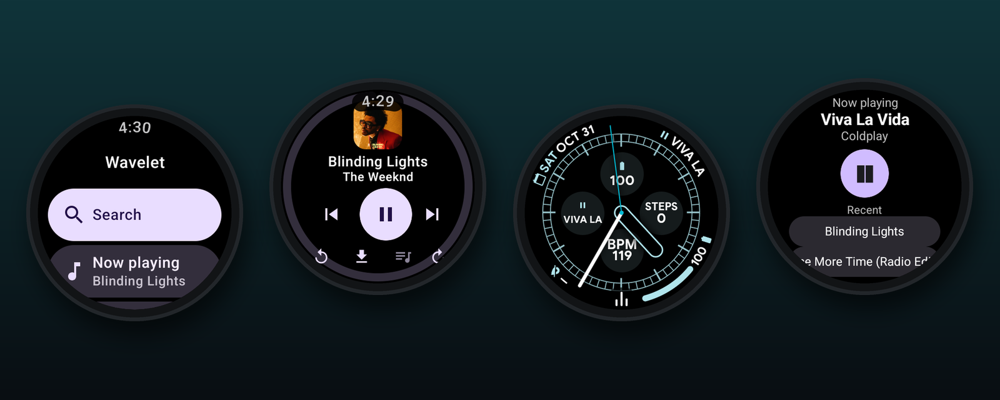
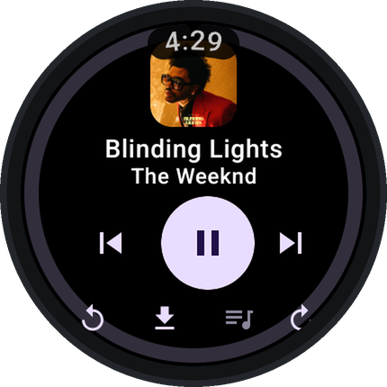
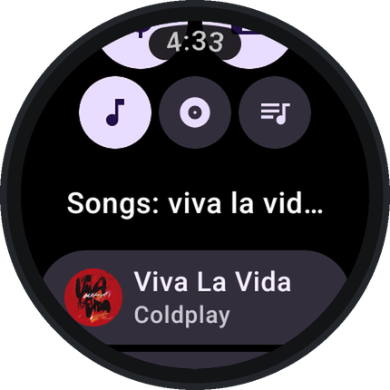
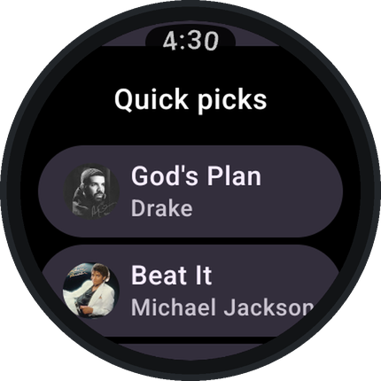
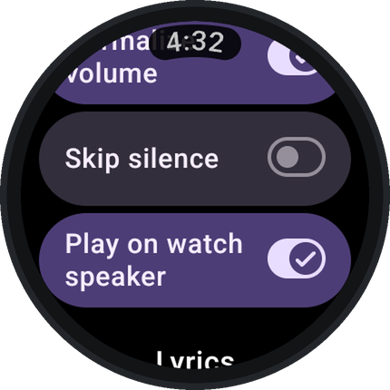
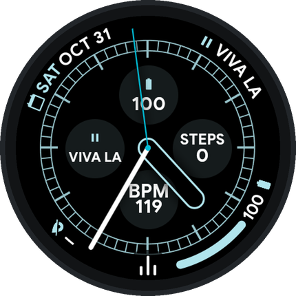
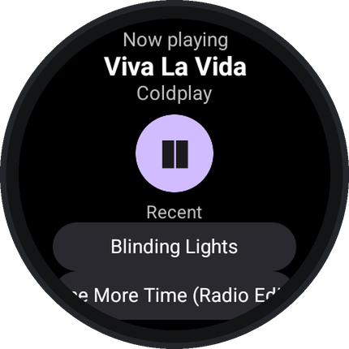
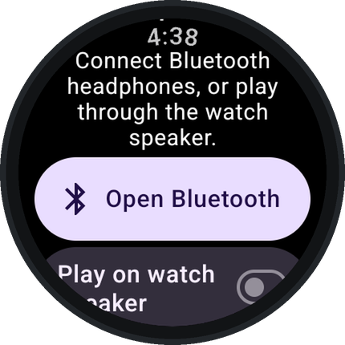
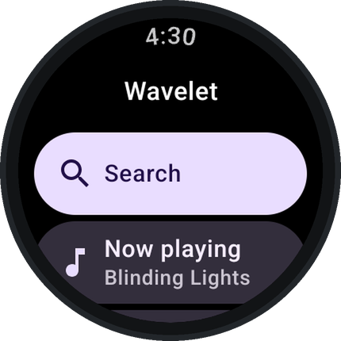

<div align="center">


# Wavelet

**YouTube Music on your Wear OS watch. Stream or download songs and leave your phone at home.**

[](https://github.com/HamzaCoder53/Metrolist/releases/latest)
[](https://github.com/HamzaCoder53/Metrolist/releases)
[](#install)
[](../LICENSE)

### [⬇ Download the watch app](https://github.com/HamzaCoder53/Metrolist/releases/latest/download/Wavelet-watch.apk) · [Website](https://hamzacoder53.github.io/Metrolist/) · [All releases](https://github.com/HamzaCoder53/Metrolist/releases)



</div>

Wavelet is a free, open-source music player for Wear OS smartwatches. It plays YouTube Music
directly on the watch over Wi-Fi or LTE, so you can go for a run with just your watch and
headphones. It's built on [Metrolist](https://github.com/MetrolistGroup/Metrolist), the
YouTube Music client for Android phones.

## Screenshots

<div align="center">

| Now Playing | Search | Quick picks | Settings |
|:---:|:---:|:---:|:---:|
|  |  |  |  |
| **Watch face complication** | **Tile** | **No headphones?** | **Home** |
|  |  |  |  |

</div>

## Features

- 🎵 **Plays on its own.** Streams YouTube Music on the watch, no phone needed. Turn the crown to change the volume.
- 🔎 **Search** songs, albums and playlists by voice or keyboard.
- ✨ **Music picked for you:** Quick picks, mixes and recommended albums on Home.
- 📚 **Your library:** sign in to get your liked songs, playlists and uploaded music.
- 📥 **Offline:** download songs, or let Wavelet cache what you've played, and listen without a connection.
- ⌚ **Watch-face complication:** play and pause right from your watch face.
- 🧩 **Tile** with what's playing and your recent songs.
- 🎧 **Headphones or speaker:** plays through Bluetooth headphones, or the watch speaker if you turn it on.
- 🎚️ Autoplay of similar songs, volume normalization, skip silence, a sleep timer and synced lyrics.
- 🔋 Low data use by default, to save battery.

## Install

1. Download [`Wavelet-watch.apk`](https://github.com/HamzaCoder53/Metrolist/releases/latest/download/Wavelet-watch.apk).
2. On the watch, open **Settings → System → About** and tap **Build number** seven times. Then in
   **Developer options**, turn on **ADB debugging** and **Wireless debugging**.
3. From a computer on the same Wi-Fi network:

   ```sh
   adb pair <watch-ip>:<pairing-port>    # enter the pairing code shown on the watch
   adb connect <watch-ip>:<port>
   adb install Wavelet-watch.apk
   ```

   You can also use a phone app that installs APKs on a watch.
4. Optional: install [`Wavelet-phone.apk`](https://github.com/HamzaCoder53/Metrolist/releases/latest/download/Wavelet-phone.apk)
   on your phone, then on the watch tap **Account → Sign in on phone**.

Wavelet needs Wear OS 3 or newer (Pixel Watch, Galaxy Watch 4 and later, TicWatch and others).

## Signing in

Signing in is optional; search and playback work without an account.

- **Sign in on phone:** sign in with the Wavelet phone app, which sends your account to the watch.
- **Sign in on watch:** Google's sign-in page on the watch, on watches that have a browser.

## Building and docs

The source lives in the [`wear`](https://github.com/HamzaCoder53/Metrolist/tree/wear/wear) module of
this fork. Build instructions and full documentation are in [`wear/README.md`](../wear/README.md).

```sh
./gradlew :wear:assembleDebug
```

## Credits and license

Wavelet is built on [Metrolist](https://github.com/MetrolistGroup/Metrolist) by the
MetrolistGroup contributors and uses their InnerTube library. Like Metrolist, it's licensed under
[GPL-3.0](../LICENSE).

**Wavelet is not affiliated with, endorsed by or sponsored by YouTube or Google.**
